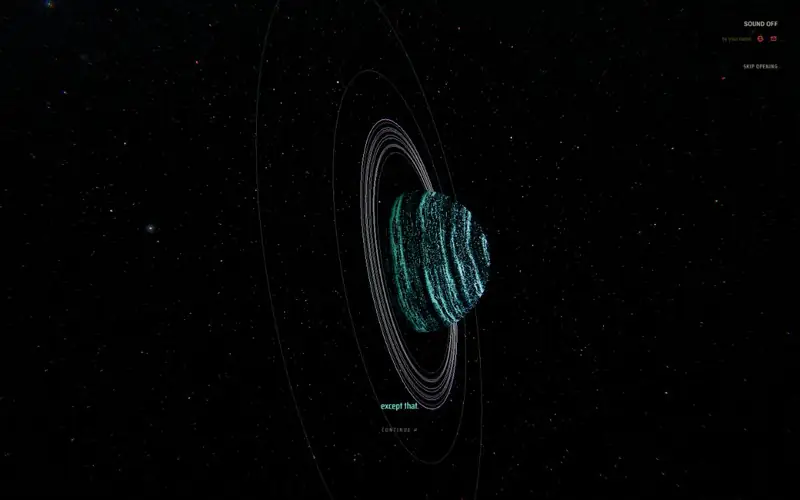
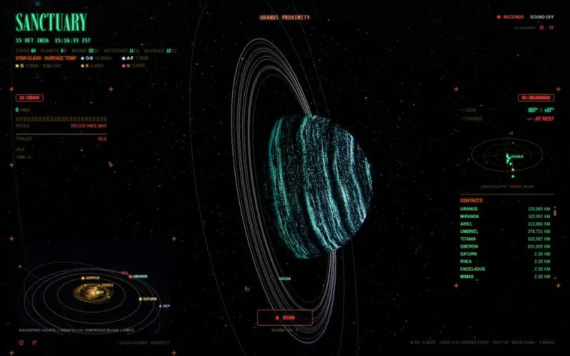
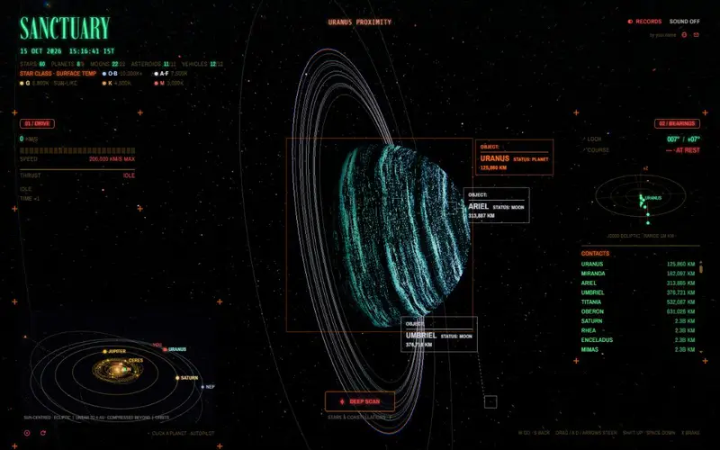
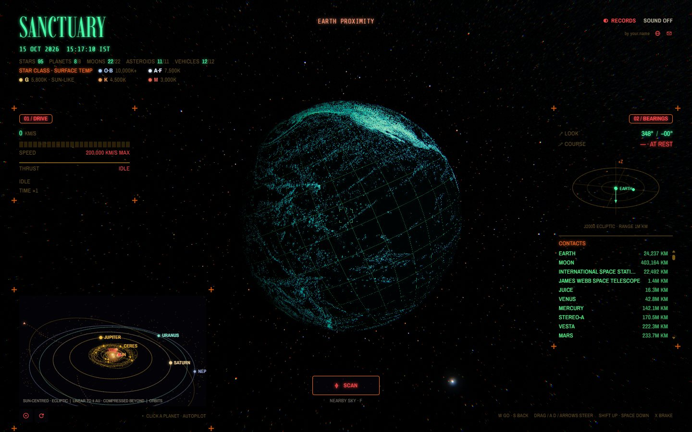
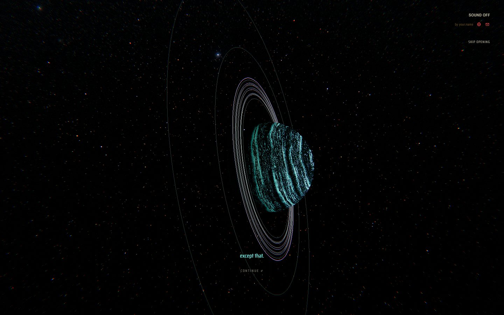
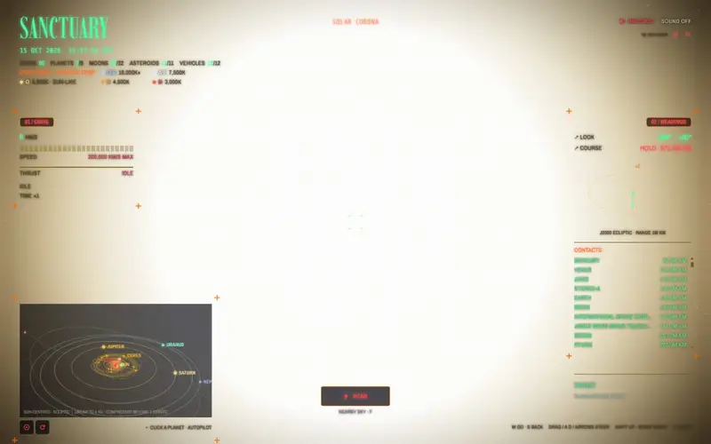
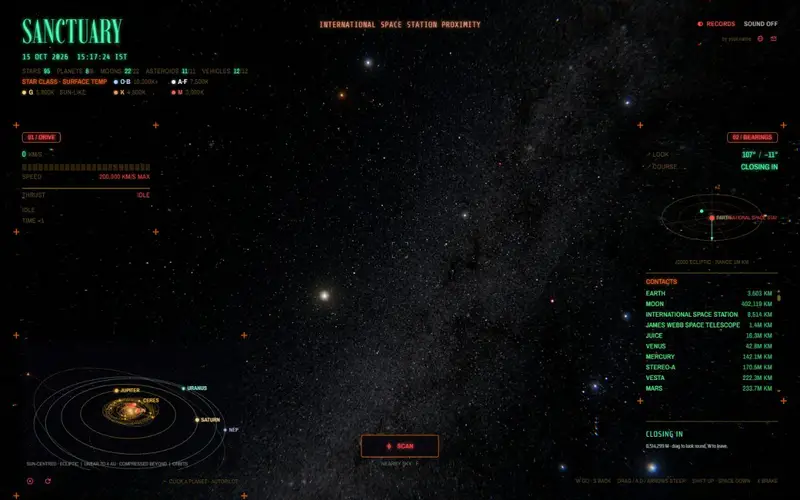
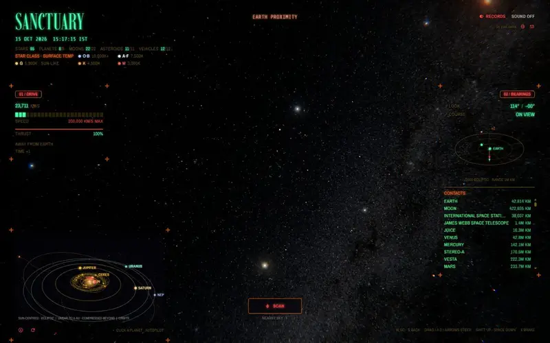

<p align="center">
  
</p>

<p align="center">
  <b>A first-person survey of the real solar system, in the browser.</b><br>
  Wake beside Uranus, scan what is in view, name the stars and fly between worlds and spacecraft
  sitting at their true positions today, at real distances.
</p>

<p align="center">
  <a href="https://sanctuary-one-sigma.vercel.app"></a>
  
  
  
  
  
</p>

<p align="center">
  
</p>

---

## Contents

- [Highlights](#highlights)
- [Tour](#tour)
  - [Scanning](#scanning)
  - [Deep scan and the night sky](#deep-scan-and-the-night-sky)
  - [Worlds](#worlds)
  - [The Sun](#the-sun)
  - [Spacecraft](#spacecraft)
  - [Flight and travel](#flight-and-travel)
  - [Solar map and radar](#solar-map-and-radar)
  - [Records](#records)
  - [On a phone](#on-a-phone)
- [Controls](#controls)
- [Getting started](#getting-started)
- [Deploying](#deploying)
- [How it works](#how-it-works)
- [Project structure](#project-structure)
- [Data and credits](#data-and-credits)

---

## Highlights

| | |
| --- | --- |
| **Real positions** | Planets, 22 moons, dwarf planets, asteroids and 12 spacecraft from JPL Horizons, carried forward to the current time |
| **Real sky** | 41,486 catalogue stars at their true positions and colours, 474 named stars, 32 constellations and the Gaia all-sky Milky Way |
| **Survey look** | NASA and USGS mission mosaics redrawn as glowing survey maps; NASA's public-domain spacecraft models in the same style |
| **A living Sun** | A blinding glare from afar; a scan dims it and shows its turning, mottled 3D surface with active regions and a red corona |
| **Flight** | Thrust, time compression up to ×100, approach assist, autopilot with gentle acceleration and braking, a slow zone through the asteroid belt |
| **Records** | Every world, moon and vehicle you identify is saved in your browser, with a rendered plate, a live 3D view and facts |
| **Light** | Heavy assets load only when needed: maps when a world is near, spacecraft models within 200,000 km |

---

## Tour

### Scanning

Press **F** (or SCAN) to read what is in view. Planets resolve within 50 million km, moons and asteroids once they
look 0.15° across, and spacecraft within 200,000 km. Anything else stays an *unidentified object* until you get
closer and scan again. Readings stay on screen while you hold the patch you scanned.

<p align="center"></p>

### Deep scan and the night sky

Scan again from the same spot and the button becomes **DEEP SCAN**: it picks out the named stars in view one by one
and draws their constellations, while dashed scan noise links nearby readings for a few seconds.

<p align="center"></p>

### Worlds

Each world's surface map is recoloured into two survey colours. Light gathers where the map has structure, its
edges and contours, as a field of bright points over a faint fill. Sunlight falls off with distance, and the
exposure adapts so outer worlds stay readable. Rings sit at their real radii. Worlds hide the stars behind them,
on their lit and dark sides alike.

<table>
  <tr>
    <td width="50%"></td>
    <td width="50%"></td>
  </tr>
  <tr>
    <td width="50%"></td>
    <td width="50%"></td>
  </tr>
</table>

### The Sun

From far out the Sun is a glare with four hairline rays that grows and brightens as you come in, about threefold
between Uranus and Earth. Fly at it and the approach assist eases you to a stop at a safe distance where its whole
disc just fits the view. Scan there and the glare steps back to show its surface, drawn on the sphere itself: a
slowly turning, mottled orange chromosphere, white-hot active regions where the day's flares rise, dark filaments,
and a deep red corona at the limb.

<p align="center"></p>

<table>
  <tr>
    <td width="50%"></td>
    <td width="50%"></td>
  </tr>
</table>

### Spacecraft

Twelve real missions fly where they are today: the ISS, James Webb, MRO, Mars Odyssey, Juno, Dawn, Juice, Psyche,
STEREO-A, New Horizons and both Voyagers. Come within 10,000 km of one for the first time and the view takes over:
it swings onto a holding side with the planet below and the Sun out of shot, and closes in until the vehicle fills
the view. Drag to look round it; W, S or X hands control back.

<p align="center"></p>

### Flight and travel

Hold **W** and the drive builds to 200,000 km/s while time compression rises to ×100; the travel optics swirl in
past 50,000 km/s. S slows to a dead stop, X brakes at once. Through the main asteroid belt (2.1–3.3 AU) the drive
eases down to 120,000 km/s and back up once you are through. Pick a world on the map and the autopilot speeds up
the same way, brakes evenly from far out, bends round anything in the way and arrives on the sunlit side.

<p align="center"></p>

### Solar map and radar

A Sun-centred 3D map (bottom left; **M** folds it) shows the orbits of the planets, dwarf planets, asteroids and
probes, the escape paths of the Voyagers and New Horizons, and the autopilot's route. Click a world to fly there.
A local radar on the right plots everything within a million kilometres, above and below the ecliptic.

<p align="center"></p>

### Records

Everything you identify or reach is kept in your browser: 54 slots across the Sun and planets, moons, dwarf planets
and asteroids, and vehicles, each with a rendered plate, a live 3D view you can turn, and facts with its current
distance from the Sun.

<p align="center"></p>

### On a phone

The whole HUD reflows for small screens: drag to look, press and hold to fly ahead.

<p align="center"></p>

---

## Controls

| Action | Desktop | Phone |
| --- | --- | --- |
| Look around | Drag, or A / D / Q / E and the arrow keys | Drag |
| Fly ahead | W (hold) | Press and hold |
| Slow down, then reverse | S (stops dead at zero; hold at rest to back away) | |
| Brake | X | |
| Up / down | Shift / Space | |
| Zoom | Mouse wheel (field of view 35°–100°) | |
| Scan, deep scan | F or the SCAN button | SCAN button |
| Solar map | M, click a world to fly there | SOLAR MAP button |
| Cancel autopilot, clear target | Esc | |
| Records | RECORDS (top right), Esc to return | RECORDS |

---

## Getting started

Requirements: Node.js 20.9 or newer and npm.

```bash
npm install
```

```bash
npm run dev
```

Then open http://localhost:3000. A production build:

```bash
npm run build
```

```bash
npm start
```

---

## Deploying

The project is a standard Next.js app with no environment variables and no server-side data, so it deploys to
[Vercel](https://vercel.com) as is: import the repository, keep the detected **Next.js** preset (build command
`next build`, install command `npm install`) and deploy. All data files are static assets under `public/`.

---

## How it works

**Scale.** One scene unit is 1,000 km. The camera always sits at the origin and every body is placed relative to it
each frame, so heliocentric distances of billions of kilometres stay precise; a logarithmic depth buffer keeps near
and far apart.

**Positions.** JPL Horizons (DE441) state vectors for 2026-10-14 00:00 UTC are propagated with two-body Kepler
motion (`src/lib/solar.ts`), which keeps planets, moons and spacecraft where they really are for months either side.

**Shapes.** Giants are flattened to their measured polar radii; small worlds are triaxial, lumpy, waisted or
spinning-top shaped; Saturn's bands and the thin rings of Uranus and Neptune sit at their real radii.

**Rendering.** Bloom touches only real highlights; travel optics and colour fringing work in linear light, then ACES
filmic tone mapping and film grain, so the black of space stays black. Spacecraft get their own soft glow pass.

**The Sun.** The everyday disc and the far glare are shaders; under a scan the same sphere switches to a procedural
surface (layered noise for the chromosphere and network, the day's active regions, filaments, limb darkening) and a
billboard corona. Nothing is downloaded for it, and the extra work runs only while a reading is on screen.

**Flight.** Thrust of 12,000 km/s², surging to 81,000 km/s² above 50,000 km/s; time compression ramps from ×1 to
×100 between 50,000 and 100,000 km/s; the course follows the view; near any surface the effective speed is limited
to the room left and you hold just above it.

**Loading.** Surface maps load once a world is large on screen (smaller maps on phones), spacecraft models within
200,000 km of them, and record plates only as they scroll into view. Sound is synthesised and starts muted.

---

## Project structure

```
src/
  app/                    layout, page, global styles, icon and social image
  components/
    Observatory.tsx       story flow and wiring between the engine and the HUD
    scene/
      engine.ts           renderer, flight model, autopilot, scanning, telemetry
      surface.ts          survey surfaces, shapes, rings, the Sun and its glare
      craft.ts            spacecraft models, their shading and orientation
      sky.ts              star field and Milky Way
      post.ts             travel optics, lens and spacecraft glow passes
      dust.ts             passing dust
    hud/                  drive, radar, contacts, scan labels, solar map
    records/              records screen, plates and live preview
  lib/
    solar.ts              bodies, facts, rings and ephemeris
    stars.ts              named stars and constellation figures
    script.ts             narrative lines
    site.ts               the HUD byline (your name and links)
    audio.ts              synthesised sound
public/
  maps/                   survey maps (2k, 1k and 512 px)
  sky/                    star catalogue and Milky Way
  craft/                  spacecraft models (meshopt-packed glTF)
scripts/
  prep-maps.py            rebuilds public/maps from downloaded mosaics
  prep-sky.py             rebuilds public/sky and the named-star list
  prep-craft.mjs          rebuilds public/craft from NASA's models
docs/media/               README images and animations
```

The scripts only matter if you want to regenerate the data; the built files are already in `public/`.

---

## Data and credits

- **Stars:** [HYG database v4.4](https://codeberg.org/astronexus/hyg) by David Nash (astronexus), CC BY-SA 4.0.
  `public/sky/stars.bin` and `src/lib/data/named-stars.json` are derived from it and shared under the same licence.
- **Milky Way:** "The colour of the sky from Gaia's Early Data Release 3", ESA/Gaia/DPAC; acknowledgement
  A. Moitinho; CC BY-SA 3.0 IGO
  ([source](https://sci.esa.int/web/gaia/-/the-colour-of-the-sky-from-gaia-s-early-data-release-3-equirectangular-projection)).
  `public/sky/milkyway-*.jpg` are resized copies under the same licence.
- **Surface maps** (public domain), reduced to brightness in `public/maps/`:
  [NASA 3D Resources](https://github.com/nasa/NASA-3D-Resources) "Images and Textures" (Venus Magellan, Mars
  Viking, Phobos, Deimos, Jupiter, the Galilean moons, Saturn and its Cassini moon mosaics, Neptune, the Uranian
  moons from Voyager 2, Pluto and Charon from New Horizons, a shaded-relief Earth); Earth: NASA Blue Marble
  ([Wikimedia Commons copy](https://commons.wikimedia.org/wiki/File:Whole_world_-_land_and_oceans_12000.jpg));
  Moon: NASA/GSFC/ASU LRO, [SVS CGI Moon Kit](https://svs.gsfc.nasa.gov/4720); Mercury: NASA/JHUAPL/CIW MESSENGER
  (PIA16298); Titan: NASA/JPL/SSI Cassini (PIA19658); Triton: NASA/JPL/USGS Voyager 2 (PIA18668); Ceres:
  NASA/JPL-Caltech/UCLA/MPS/DLR/IDA Dawn (PIA20354), via the [NASA Photojournal](https://science.nasa.gov/photojournal/).
  Uranus, Vesta, Pallas, Hygiea, Psyche, Hyperion and the small asteroids use procedural stand-ins.
- **Spacecraft models** (public domain), simplified in `public/craft/`:
  [NASA 3D Resources](https://github.com/nasa/NASA-3D-Resources) "3D Models" (International Space Station (B),
  James Webb Space Telescope (B), Mars Reconnaissance Orbiter (A), Mars Odyssey, Juno (A), Dawn, STEREO, Voyager
  Probe (B)) and New Horizons by NASA VTAD
  ([science.nasa.gov](https://science.nasa.gov/resource/new-horizons-3d-model/)). Juice and Psyche have no public
  model and are built from parts in code.
- **Positions:** [JPL Horizons](https://ssd.jpl.nasa.gov/horizons/). **Facts:** NASA and ESA mission pages.
- The Sun's surface under a scan is procedural and illustrative; its active regions are seeded by the date.
