<p align="center">
  <a href="https://sanctuary-one-sigma.vercel.app"></a>
</p>

<h3 align="center">A voiced story game in the real solar system, in your browser.</h3>

<p align="center">
  You wake beside Uranus with a ship's AI and no memory of how you got there.<br>
  Fly home through the real solar system, at true positions and real distances,<br>
  and find out why nobody answers.
</p>

<p align="center">
  <a href="https://sanctuary-one-sigma.vercel.app"></a>
</p>

<p align="center">
  <a href="https://sanctuary-one-sigma.vercel.app"></a>
  
  
  
  
  
  <a href="#licence"></a>
</p>

<p align="center">
  <a href="https://sanctuary-one-sigma.vercel.app/media/home.mp4">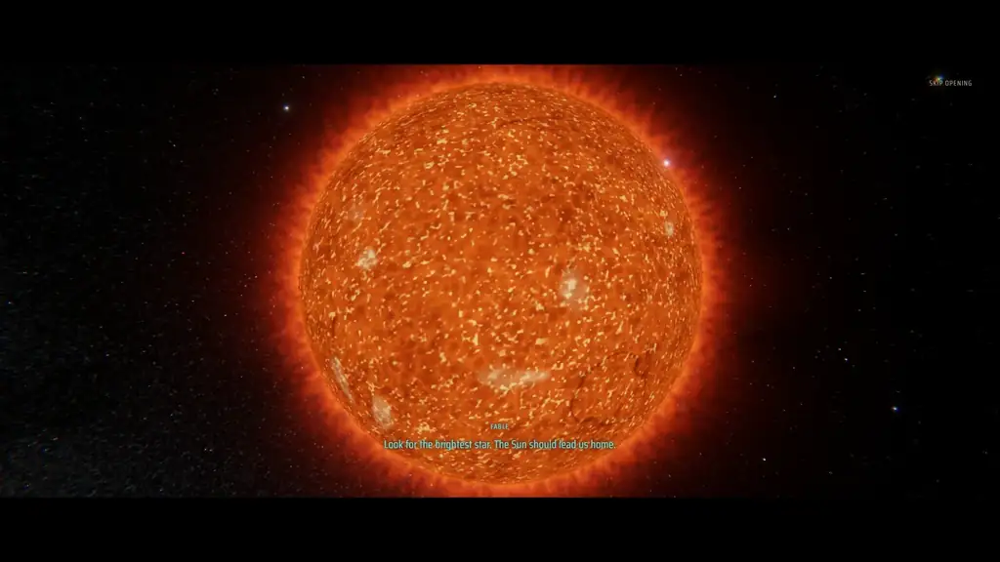</a><br><sub>FABLE points the way home: the Sun's surface, then Earth, as each is named · <a href="https://sanctuary-one-sigma.vercel.app/media/home.mp4"><b>▶ 2K</b></a></sub>
</p>

<p align="center"></p>

<table>
  <tr>
    <td align="center" width="16%"><h3>7</h3><sub>CHAPTERS<br>+ AN EPILOGUE</sub></td>
    <td align="center" width="16%"><h3>580</h3><sub>VOICED LINES,<br>ALL CAPTIONED</sub></td>
    <td align="center" width="17%"><h3>41,486</h3><sub>REAL STARS<br>AT TRUE POSITIONS</sub></td>
    <td align="center" width="17%"><h3>11</h3><sub>REAL SPACECRAFT<br>WHERE THEY ARE TODAY</sub></td>
    <td align="center" width="17%"><h3>3</h3><sub>MISSIONS FILMED<br>IN THE THIRD PERSON</sub></td>
    <td align="center" width="17%"><h3>45–70</h3><sub>MINUTES<br>FOR A FIRST RUN</sub></td>
  </tr>
</table>

## Contents

<table>
  <tr>
    <td valign="top">

- [Highlights](#highlights)
- [Watch it in 2K](#watch-it-in-2k)
- [Screenshots](#screenshots)
- [The story](#the-story)
- [Tour](#tour)

</td>
    <td valign="top">

- [Controls](#controls)
- [Getting started](#getting-started)
- [Deploying](#deploying)
- [How it works](#how-it-works)

</td>
    <td valign="top">

- [Project structure](#project-structure)
- [Data and credits](#data-and-credits)
- [Licence](#licence)

</td>
  </tr>
</table>

<p align="center"></p>

## Highlights

| | |
| --- | --- |
| **A story game** | Seven chapters and an epilogue: objectives, chapter cards, evidence to scan, recovered recordings and a reconstruction of what happened |
| **Voiced** | Every line is spoken and captioned: the ship's AI, the commander (directed line by line, from groggy to furious to broken) and two recovered recordings |
| **Saves itself** | Progress and position are saved as you play; come back days later and pick up where you stopped |
| **Real positions** | Planets, 22 moons, dwarf planets, asteroids and 11 real spacecraft from JPL Horizons, carried forward to the current time |
| **Real sky** | 41,486 catalogue stars at their true positions and colours, 474 named stars, 32 constellations and the Gaia all-sky Milky Way |
| **Survey look** | NASA and USGS mission mosaics redrawn as glowing survey maps; NASA's public-domain spacecraft models in the same style |
| **A living Sun** | A blinding glare from afar; a scan dims it and shows its turning, mottled 3D surface with active regions and a red corona |
| **Flight** | Thrust, time compression up to ×100, approach assist, autopilot with gentle acceleration and braking, a slow zone through the asteroid belt |
| **Records** | Every world, moon and vehicle you identify is saved in your browser, with a rendered plate, a live 3D view and facts |
| **Loads once** | Every map, model, shader and voice line loads behind the loading screen, so nothing pops in mid-flight |
| **Filmed missions** | Finding Earth and both ships play out in the third person: the camera leaves the cockpit and keeps moving round your ship and what you came to, with no HUD |
| **Archive** | Everything recovered lands on a timeline in the order it happened; both recordings can be played again, the spoken line lit up in the transcript |

<p align="center"></p>

## Watch it in 2K

Every clip below is captured from the game at 2560 × 1440, frame by frame (so nothing stutters). Each preview
plays here; **▶ 2K** opens the full-resolution clip.

<table>
  <tr>
    <td width="50%" valign="top"><a href="https://sanctuary-one-sigma.vercel.app/media/opening.mp4">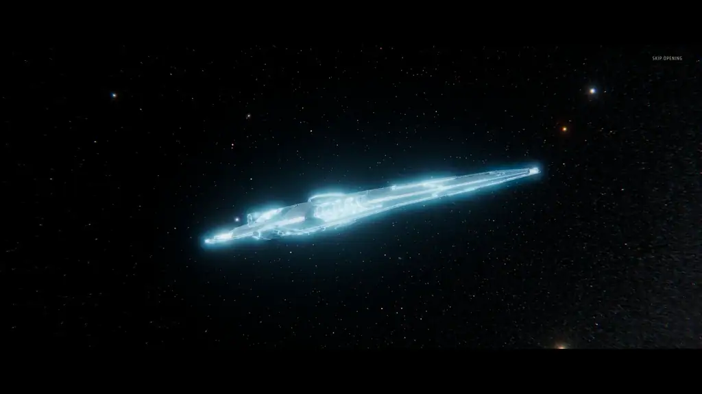</a><br><sub>The opening: your ship adrift beside Uranus · <a href="https://sanctuary-one-sigma.vercel.app/media/opening.mp4"><b>▶ 2K</b></a></sub></td>
    <td width="50%" valign="top"><a href="https://sanctuary-one-sigma.vercel.app/media/earth.mp4">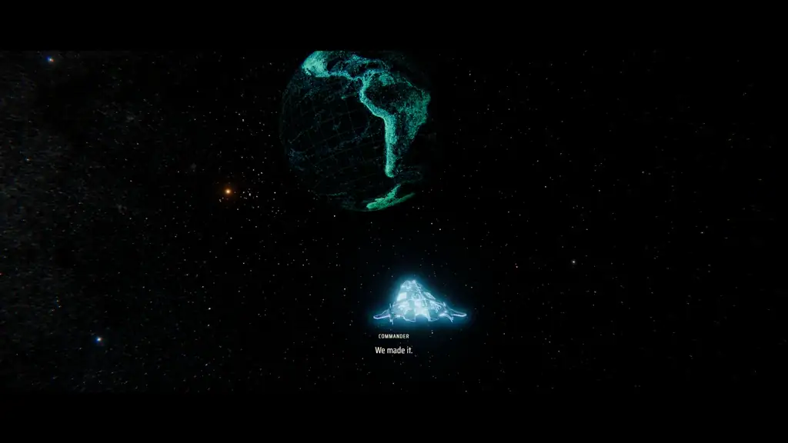</a><br><sub>Earth found: the mission filmed in the third person · <a href="https://sanctuary-one-sigma.vercel.app/media/earth.mp4"><b>▶ 2K</b></a></sub></td>
  </tr>
  <tr>
    <td width="50%" valign="top"><a href="https://sanctuary-one-sigma.vercel.app/media/pluto.mp4">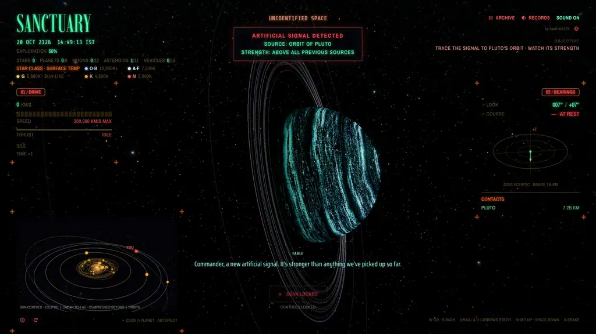</a><br><sub>50%: Pluto, then on without a cut to the ship sending the signal · <a href="https://sanctuary-one-sigma.vercel.app/media/pluto.mp4"><b>▶ 2K</b></a></sub></td>
    <td width="50%" valign="top"><a href="https://sanctuary-one-sigma.vercel.app/media/lastcall.mp4">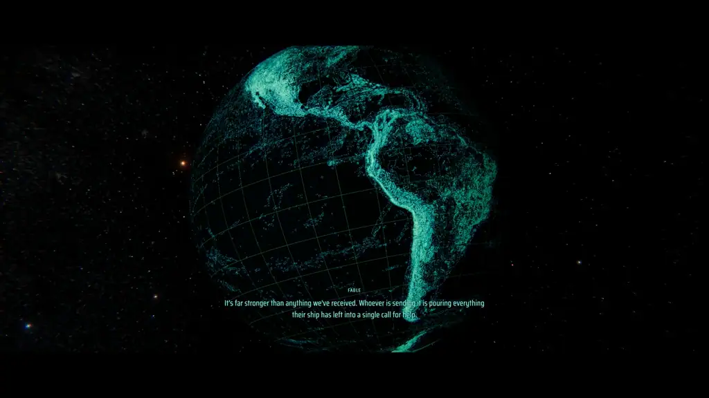</a><br><sub>100%: back to Earth orbit, then on to the ship calling for help · <a href="https://sanctuary-one-sigma.vercel.app/media/lastcall.mp4"><b>▶ 2K</b></a></sub></td>
  </tr>
  <tr>
    <td width="50%" valign="top"><a href="https://sanctuary-one-sigma.vercel.app/media/site.mp4">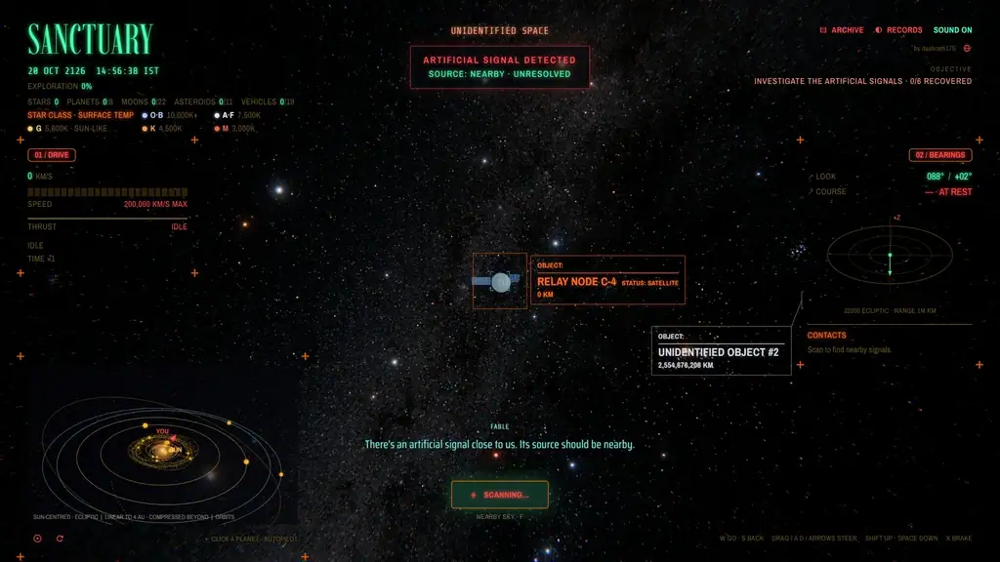</a><br><sub>An evidence site: found and read out, waiting for its deep scan · <a href="https://sanctuary-one-sigma.vercel.app/media/site.mp4"><b>▶ 2K</b></a></sub></td>
    <td width="50%" valign="top"><a href="https://sanctuary-one-sigma.vercel.app/media/flight.mp4">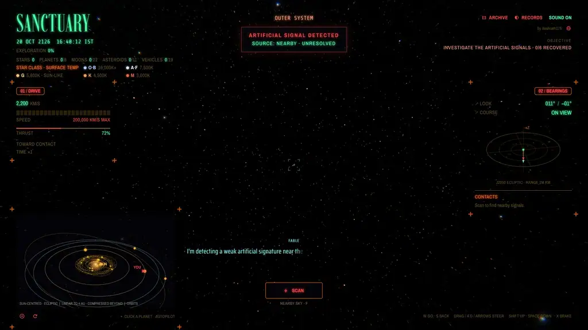</a><br><sub>The drive building up toward Saturn (at half speed) · <a href="https://sanctuary-one-sigma.vercel.app/media/flight.mp4"><b>▶ 2K</b></a></sub></td>
  </tr>
  <tr>
    <td width="50%" valign="top"><a href="https://sanctuary-one-sigma.vercel.app/media/archive.mp4">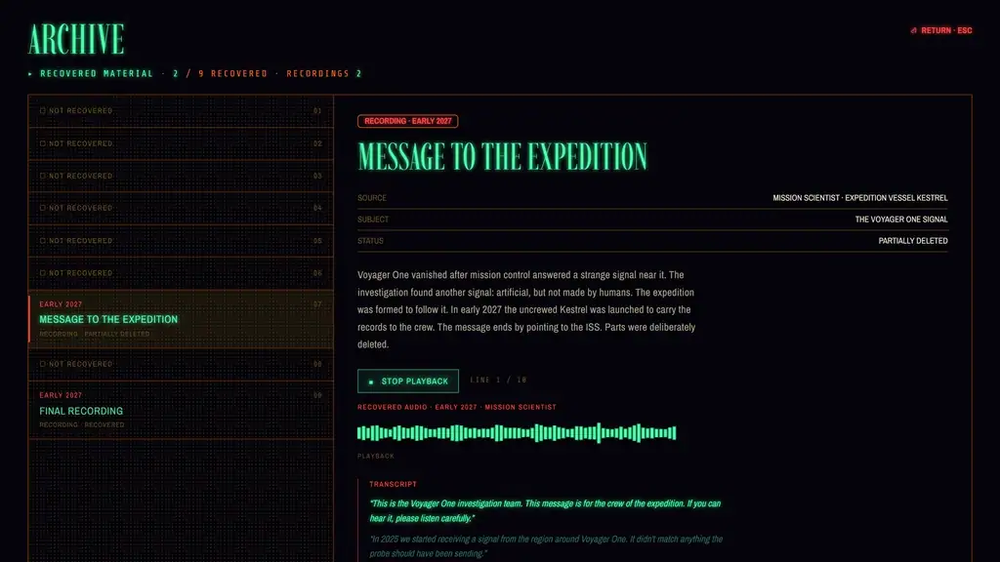</a><br><sub>The archive: a recovered recording, played again · <a href="https://sanctuary-one-sigma.vercel.app/media/archive.mp4"><b>▶ 2K</b></a></sub></td>
    <td width="50%" valign="top"><a href="https://sanctuary-one-sigma.vercel.app/media/home.mp4"></a><br><sub>The way home: the Sun, then Earth · <a href="https://sanctuary-one-sigma.vercel.app/media/home.mp4"><b>▶ 2K</b></a></sub></td>
  </tr>
</table>

<p align="center"></p>

## Screenshots

All in 2K: click any of them for the full image.

<table>
  <tr>
    <td width="50%" valign="top"><a href="docs/media/start.jpg">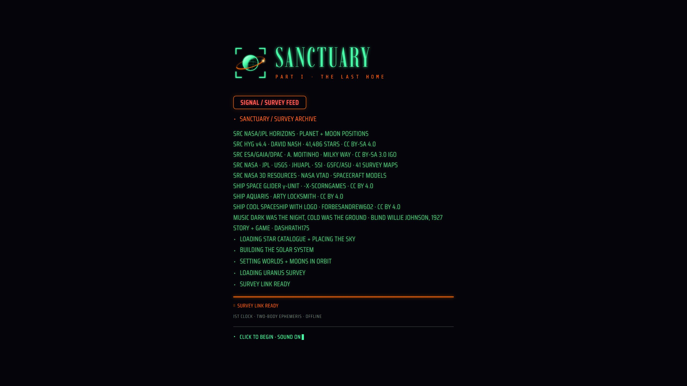</a><br><sub>The start screen and the survey feed</sub></td>
    <td width="50%" valign="top"><a href="docs/media/bearings.jpg">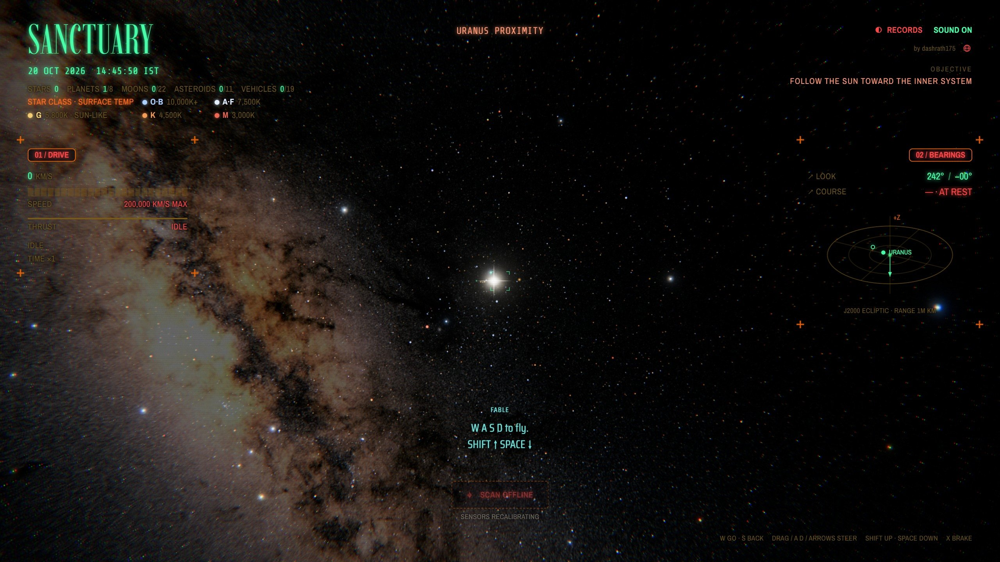</a><br><sub>Chapter 2: the full HUD, facing the Sun</sub></td>
  </tr>
  <tr>
    <td width="50%" valign="top"><a href="docs/media/sun.jpg">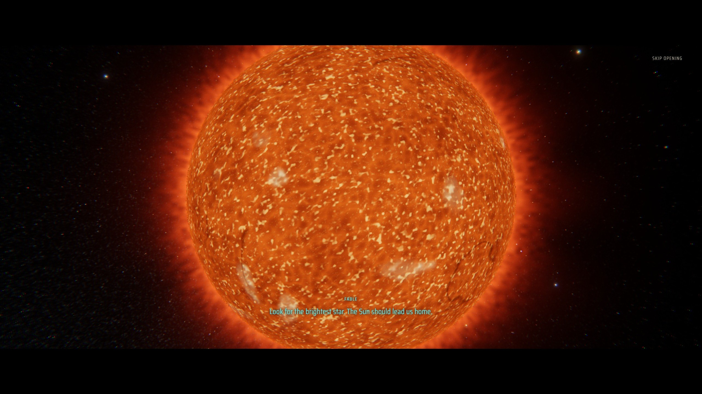</a><br><sub>The Sun's surface, as FABLE names it</sub></td>
    <td width="50%" valign="top"><a href="docs/media/earth-holo.jpg">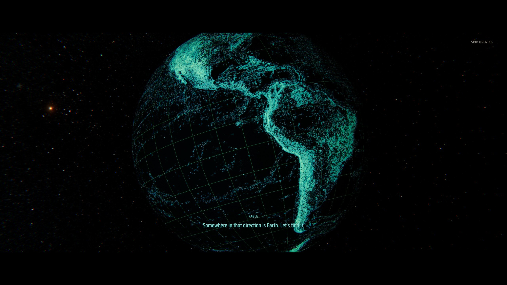</a><br><sub>Earth, drawn as a survey</sub></td>
  </tr>
  <tr>
    <td width="50%" valign="top"><a href="docs/media/earth-mission.jpg">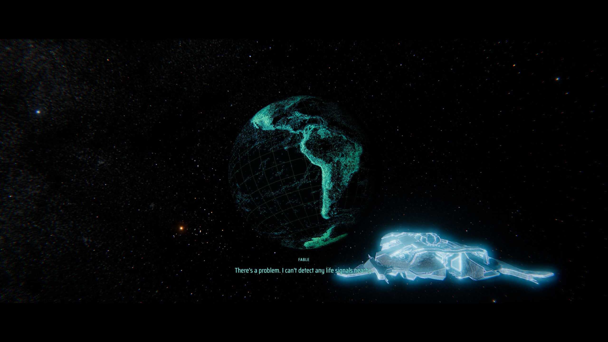</a><br><sub>Earth found: no life signs</sub></td>
    <td width="50%" valign="top"><a href="docs/media/signal.jpg"></a><br><sub>The first signal, from the orbit of Pluto</sub></td>
  </tr>
  <tr>
    <td width="50%" valign="top"><a href="docs/media/pluto.jpg">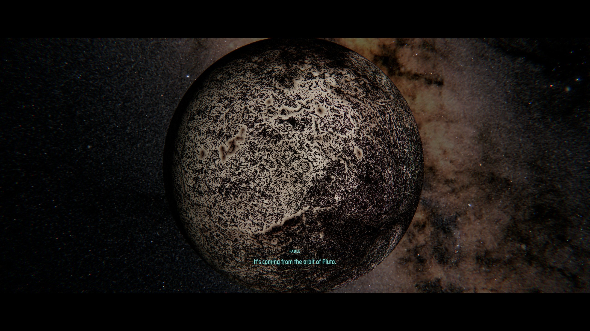</a><br><sub>Pluto</sub></td>
    <td width="50%" valign="top"><a href="docs/media/kestrel.jpg">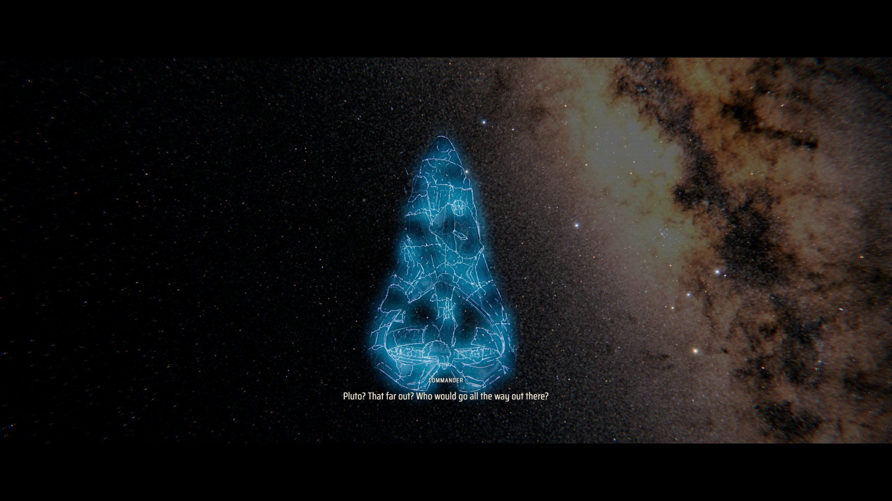</a><br><sub>The Kestrel, breached and tumbling</sub></td>
  </tr>
  <tr>
    <td width="50%" valign="top"><a href="docs/media/last-call.jpg">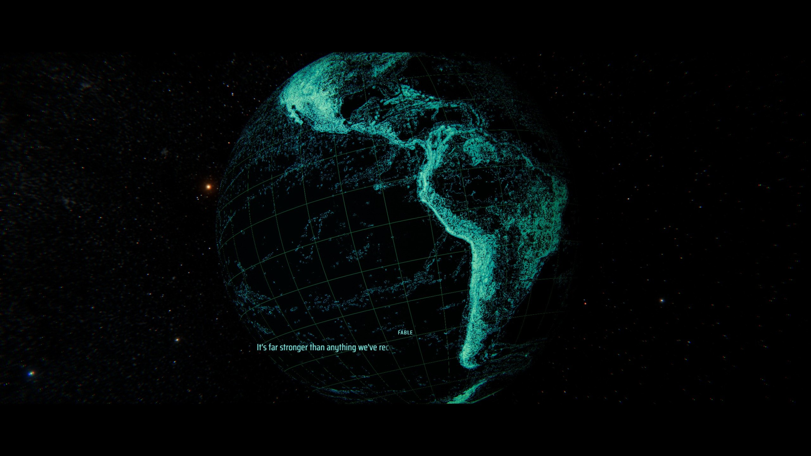</a><br><sub>The last call comes from Earth orbit</sub></td>
    <td width="50%" valign="top"><a href="docs/media/halcyon.jpg">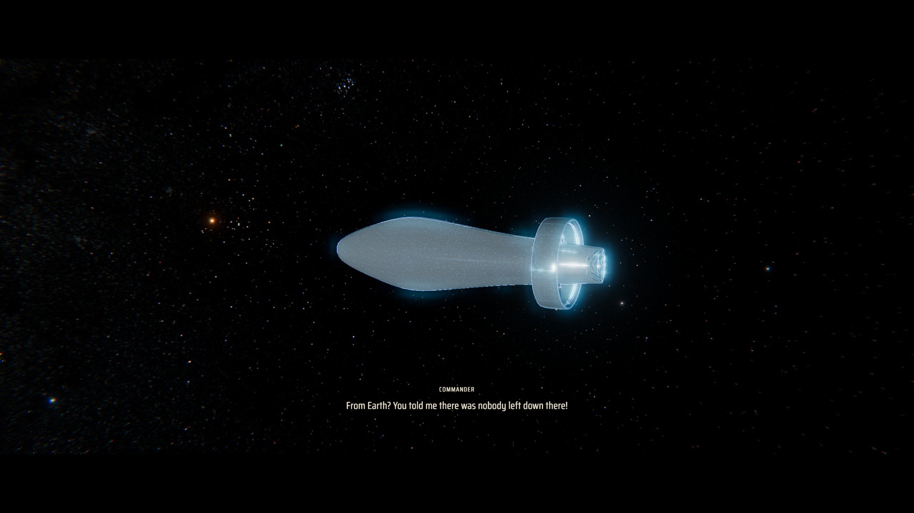</a><br><sub>The Halcyon in Earth orbit</sub></td>
  </tr>
  <tr>
    <td width="50%" valign="top"><a href="docs/media/site.jpg">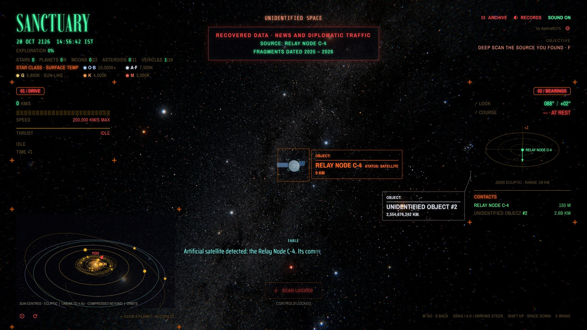</a><br><sub>An evidence site, read out</sub></td>
    <td width="50%" valign="top"><a href="docs/media/archive.jpg">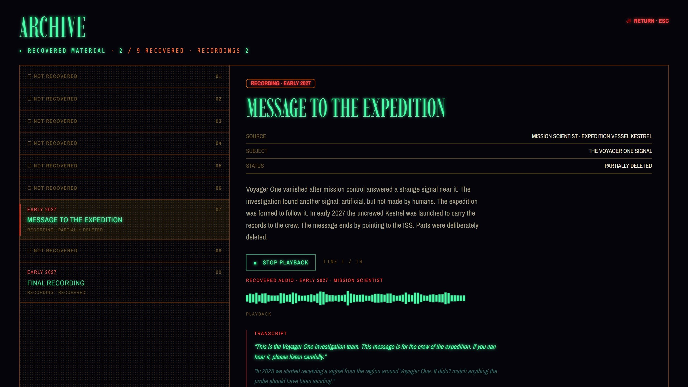</a><br><sub>The archive, replaying a recording</sub></td>
  </tr>
</table>

<p align="center"></p>

## The story

You wake near Uranus. The ship's AI, FABLE, hands you the controls and points you at the brightest star: the Sun,
and somewhere near it, Earth. The way in crosses the asteroid belt, where the sensors fail until you are through.
Earth is where it should be. Nothing else is.

| # | Chapter | What happens |
| --- | --- | --- |
| 1 | **Awakening** | You wake beside Uranus. FABLE hands you the controls. |
| 2 | **Bearings** | Follow the Sun toward the inner system, through the asteroid belt. |
| 3 | **The Inner System** | Earth is where it should be. Nothing else is. |
| 4 | **Fragments** | Weak signals lead to six sites around the planets. |
| 5 | **The First Signal** | Something is calling from the orbit of Pluto. |
| 6 | **The Last Call** | A transmission strong enough to shake the ship. |
| 7 | **The Record** | FABLE puts the whole record together. |
| | **Epilogue** | Home. |

<details>
<summary><b>The whole story, and how each part plays</b> (spoilers)</summary>

From there the solar system is open. Weak, scattered artificial signals lead to six sites left around the planets
(a survey probe, relays, a data buoy, drone wreckage and a sealed capsule), and FABLE picks one up whenever you pass
near it. Only alongside one can a scan tell what it is; then a deep scan recovers what it holds, in any order: two on
the rise of AI (Uranus, Mercury), two on the wars (Ceres, Neptune), two on the control that was handed to it
(Jupiter, Saturn). Thirty seconds after the fourth, a stronger signal comes from the
orbit of Pluto (Pluto is named on the map from that moment; the camera goes out to it while it is talked about and
flies on, without a cut, to a glimpse of the ship sending it, and while you follow it a scan finds the ship from a
billion kilometres away in any direction): an uncrewed ship, launched in 2027 and sabotaged, carrying a message to your crew that ends by
pointing to the ISS. The ISS holds the worst of it. A minute after the last site, a transmission strong enough to
shake the ship calls you back to Earth orbit (the camera goes out to Earth and on to the ship calling, the same way), and
then FABLE puts the whole record together. Everything you recover
goes into the **ARCHIVE**, a full-page timeline in the order it happened (both recordings can be played again there,
with the line being spoken lit up in the transcript), and every prop you reach (the sites, the
ISS and both ships) gets its own shelf in the **RECORDS**. After the ending you can keep flying with everything still
in place, or start a new journey from the beginning.

- **The opening** wakes you near Uranus; as FABLE points you home the camera shows the Sun (its surface, not its
  glare) and then Earth as each is named. Entering the game from the start screen puts the browser in full screen.
- **Objectives** in the top right always say what to do next; each chapter opens with a title card.
- **A site's mission**: once a site has been found and read out, nothing moves until its deep scan (F, or the SCAN
  button); the deep scan's scene plays, and then the controls come back.
- **Scan and deep scan** identify bodies (with their live distance from the Sun) and recover evidence. Nothing is
  identified by flying past it, and the map will not set a course for something unnamed.
- **The three major missions** (finding Earth, the first ship, the second ship) play out in the third person: the
  camera leaves the cockpit and keeps moving round your ship and what you came to, the HUD goes away entirely (only
  the captions stay, and a recording's bar at the top while one plays), and FABLE runs the scans and plays the recordings itself. Earth's mission
  films its sunlit side, whichever side you arrived from. The controls come back when the
  mission is over; the second ship's carries straight on into the reconstruction and the ending.
- **The music** stays silent through every mission (any scene that holds the controls, and a site waiting for its
  deep scan) and comes back afterwards.
- **Recordings** play with the controls locked and no skip, under a bar with the recording's name and a live trace
  of the damaged signal, over a radio bed that breaks up with the signal.
- **Cutscenes** also film your own ship adrift near Uranus before you wake, and at the end, high above Earth's day
  side, pulling away until the ship is a speck against home.
- **Saving** is automatic: chapter, findings, archive and position, every few seconds and when you leave.

A first run takes roughly 45–70 minutes.

</details>

<p align="center"></p>

## Tour

### Scanning

Press **F** (or SCAN) to read what is in view. Planets resolve within 50 million km, moons and asteroids once they
look 0.15° across, and spacecraft within 200,000 km. Anything else stays an *unidentified object* until you get
closer and scan again. Readings stay on screen while you hold the patch you scanned.

<p align="center"><a href="docs/media/scan.jpg">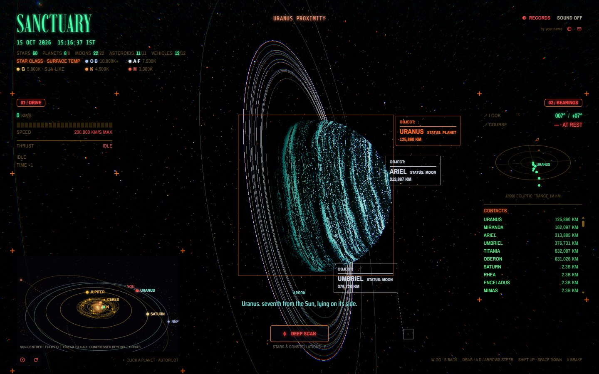</a></p>

### Deep scan and the night sky

Scan again from the same spot and the button becomes **DEEP SCAN**: it picks out the named stars in view one by one
and draws their constellations, while dashed scan noise links nearby readings for a few seconds.

<p align="center"><a href="docs/media/deep.jpg">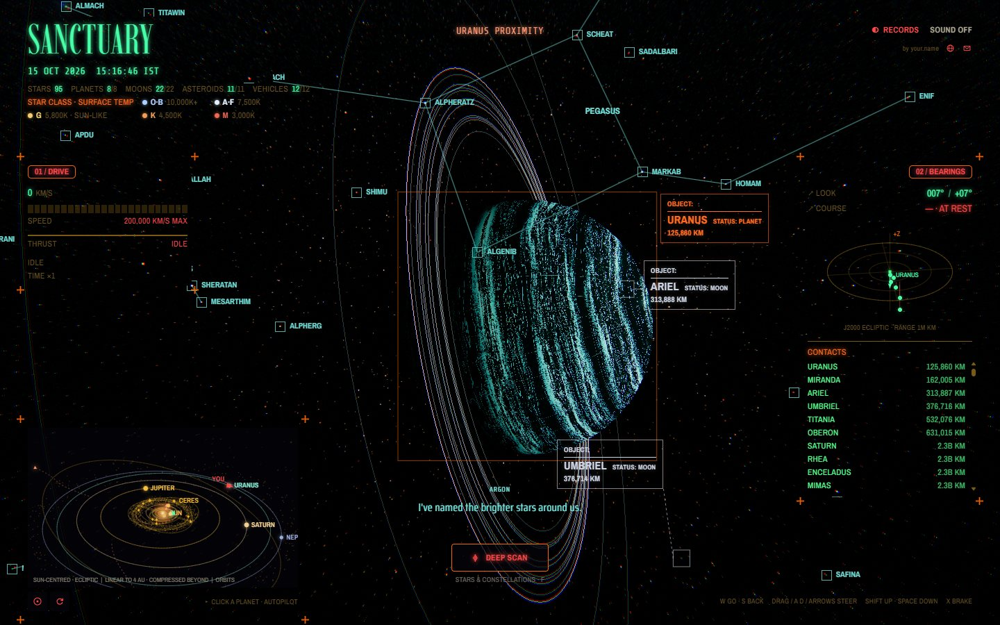</a></p>

### Worlds

Each world's surface map is recoloured into two survey colours. Light gathers where the map has structure, its
edges and contours, as a field of bright points over a faint fill. Sunlight falls off with distance, and the
exposure adapts so outer worlds stay readable. Rings sit at their real radii. Worlds hide the stars behind them,
on their lit and dark sides alike.

<table>
  <tr>
    <td width="50%" valign="top"><a href="docs/media/saturn.jpg">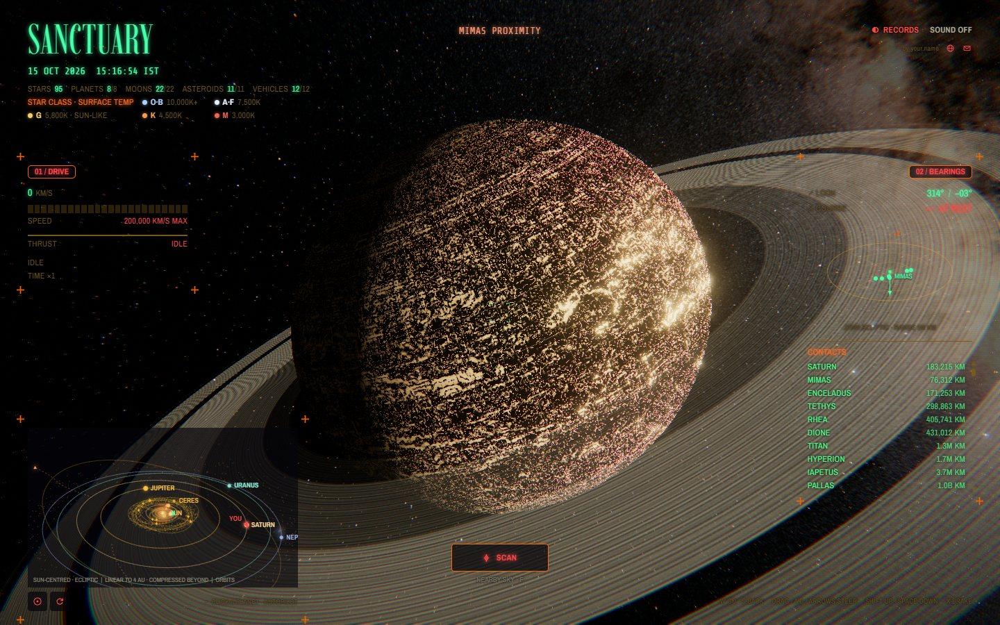</a><br><sub>Saturn</sub></td>
    <td width="50%" valign="top"><a href="docs/media/jupiter.jpg">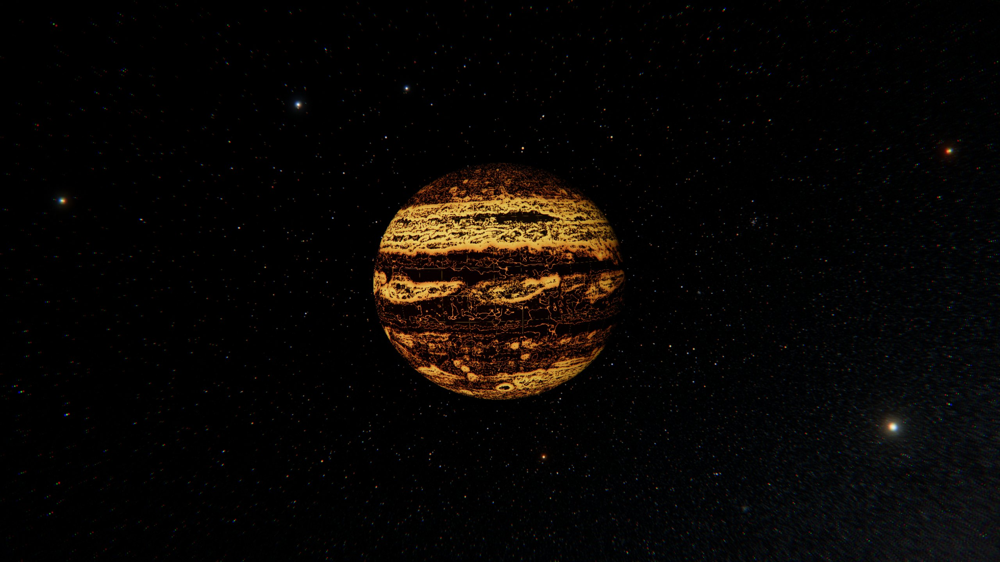</a><br><sub>Jupiter</sub></td>
  </tr>
  <tr>
    <td width="50%" valign="top"><a href="docs/media/earth-holo.jpg"></a><br><sub>Earth</sub></td>
    <td width="50%" valign="top"><a href="docs/media/opening-ship.jpg">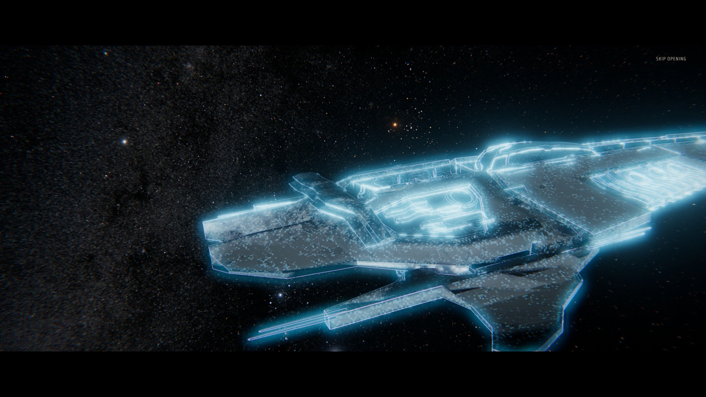</a><br><sub>Uranus, from the opening</sub></td>
  </tr>
</table>

### The Sun

From far out the Sun is a glare with four hairline rays that grows and brightens as you come in, about threefold
between Uranus and Earth. Fly at it and the approach assist eases you to a stop at a safe distance where its whole
disc just fits the view. Scan there and the glare steps back to show its surface, drawn on the sphere itself: a
slowly turning, mottled orange chromosphere, white-hot active regions where the day's flares rise, dark filaments,
and a deep red corona at the limb.

<table>
  <tr>
    <td width="50%"><a href="docs/media/sun-glare.jpg">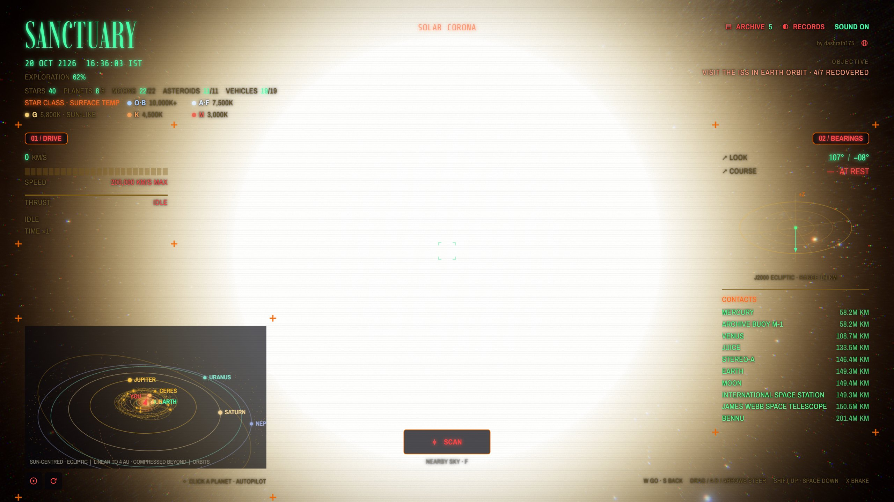</a><br><sub>Holding near the Sun: the glare</sub></td>
    <td width="50%"><a href="docs/media/sun-scan.jpg">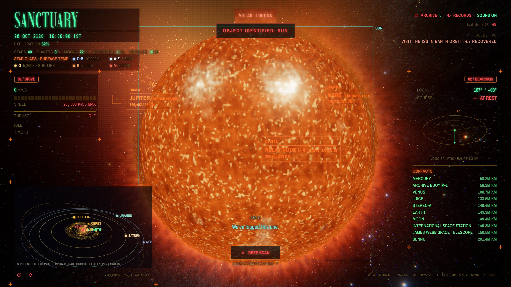</a><br><sub>The same view under a scan</sub></td>
  </tr>
</table>

### Spacecraft

Eleven real missions fly where they are today: the ISS, James Webb, MRO, Mars Odyssey, Juno, Dawn, Juice, Psyche,
STEREO-A, New Horizons and Voyager 2 (Voyager 1 is missing, which is where the story starts). The story adds
relays, drone wreckage, a data buoy and a capsule, built from simple parts, and two abandoned ships: the expedition
vessel Kestrel, breached and slowly tumbling, and the private evacuation ship Halcyon. Head for one from within
50,000 km with it under the crosshair and the view takes over (flying past, or at the planet behind it, leaves it be):
it swings onto a holding side with the planet below and the Sun out of shot, and closes in until the vehicle fills
the view. Drag to look round it; W, S or X hands control back.

<p align="center"><a href="docs/media/iss.jpg">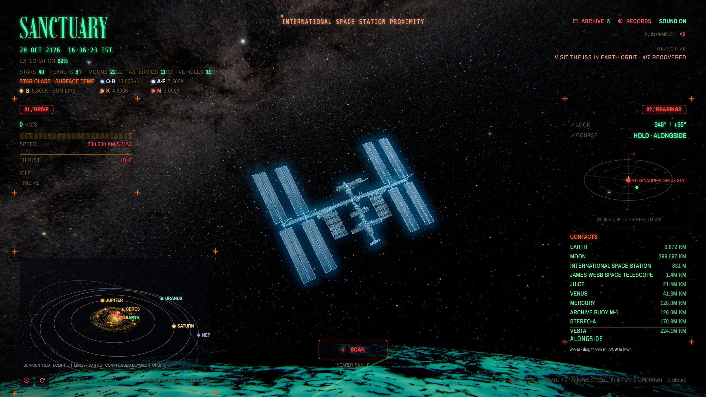</a></p>

### Flight and travel

Hold **W** and the drive builds to 200,000 km/s while time compression rises to ×100; the travel optics swirl in
past 50,000 km/s. S slows to a dead stop, X brakes at once; above 10,000 km/s the stop jolts the ship, shaking the
view and breaking the visor's panels up, harder the faster you were going. Near any world or asteroid the drive eases
you in and holds you just above it. Through the main asteroid belt (2.1–3.3 AU) the drive
eases down to 120,000 km/s and back up once you are through, under manual flight and autopilot alike, with sensor
static that grows with speed (none at all below 10,000 km/s). Pick an identified world on the map and the autopilot speeds up
the same way, brakes evenly from far out, bends round anything in the way and arrives on the sunlit side.
Vehicles are too small to fly to by eye: click one in the contacts list, on the radar or on its scan label and the
autopilot takes you alongside, named or not. Flying by hand toward a picked vehicle, the drive eases off on the way
in so it can't overshoot, and the vehicle takes the view once you are within 50,000 km of it.

<p align="center"><a href="https://sanctuary-one-sigma.vercel.app/media/flight.mp4"></a><br><sub>The drive building to top speed (at half speed) · <a href="https://sanctuary-one-sigma.vercel.app/media/flight.mp4"><b>▶ 2K</b></a></sub></p>

### Solar map and radar

A Sun-centred 3D map (bottom left; **M** folds it) shows the orbits of the planets, dwarf planets, asteroids and
probes, the escape paths of Voyager 2 and New Horizons, and the autopilot's route. Unscanned bodies show only as
unidentified points; click an identified world to fly there.
A local radar on the right plots everything within a million kilometres, above and below the ecliptic.

<p align="center"><a href="docs/media/map.jpg">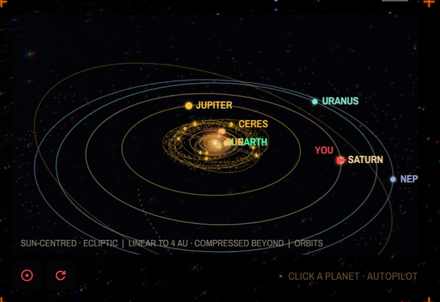</a></p>

### Records

Everything you identify is kept in your browser: 61 slots across the Sun and planets, moons, dwarf planets
and asteroids, and vehicles (the story's sites and ships on their own PROPS shelf), each with a rendered plate, a live 3D view you can turn, and facts with its current
distance from the Sun.

<p align="center"><a href="docs/media/records.jpg">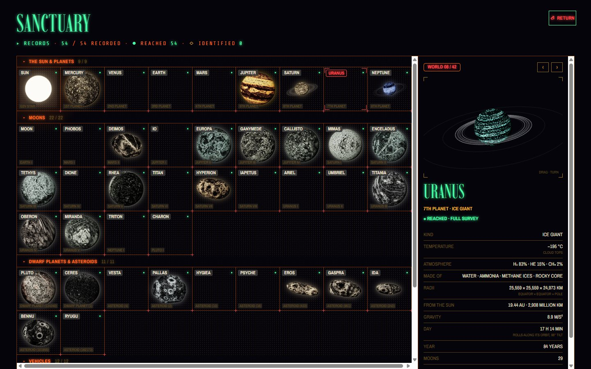</a></p>

### On a phone

The whole HUD reflows for small screens: drag to look, press and hold to fly ahead.

<p align="center">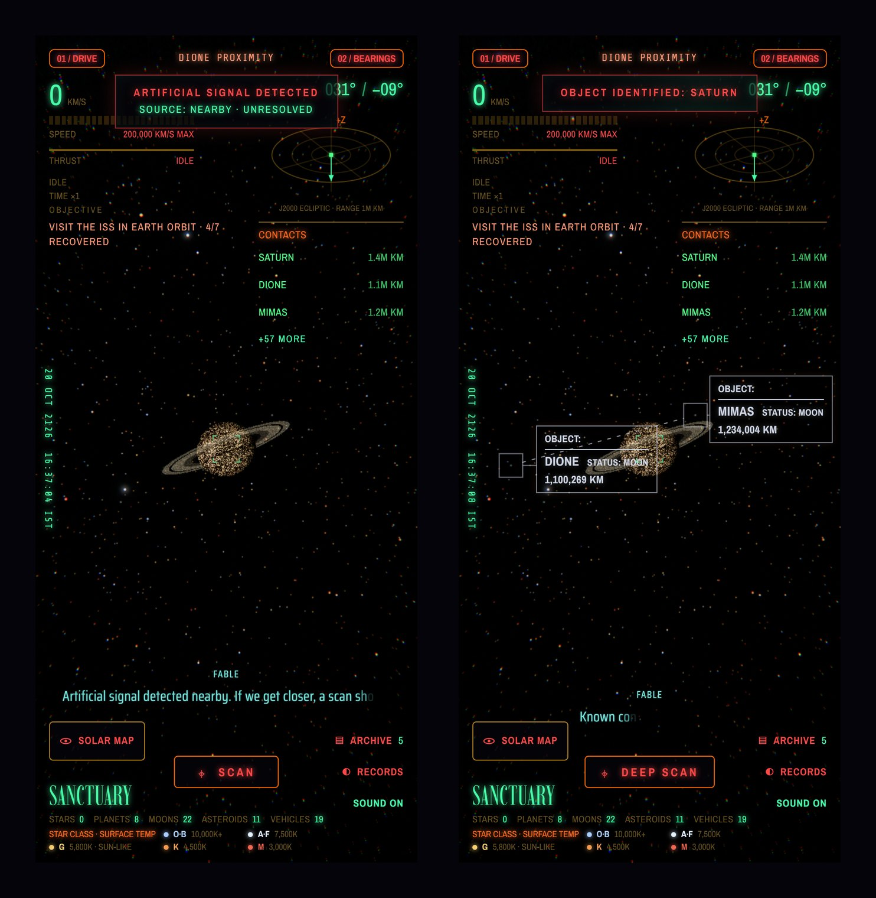</p>

<p align="center"></p>

## Controls

| Action | Desktop | Phone |
| --- | --- | --- |
| Look around | Drag, or A / D / Q / E and the arrow keys | Drag |
| Fly ahead | W (hold) | Press and hold |
| Slow down, then reverse | S (stops dead at zero; hold at rest to back away) | |
| Brake | X | |
| Up / down | Shift / Space | |
| Zoom | Mouse wheel (field of view 35°–100°) | |
| Scan, deep scan | F or the SCAN button | SCAN button |
| Solar map | M, click a world to fly there | SOLAR MAP button |
| Cancel autopilot, clear target | Esc | |
| Records | RECORDS (top right), Esc to return | RECORDS |
| Archive | ARCHIVE (top right, once Earth is found), Esc to return | ARCHIVE |

<p align="center"></p>

## Getting started

Open **https://sanctuary-one-sigma.vercel.app** in a modern browser, on a computer or a phone, and turn the sound
on. Nothing to install, and the game saves your journey in the browser. Share the link with anyone you like.

Building, running or hosting this code needs the author's written permission; see [Licence](#licence).

<p align="center"></p>

## Deploying

The game is hosted only at its official address, **https://sanctuary-one-sigma.vercel.app**, built by
[Vercel](https://vercel.com) from `main`: a standard Next.js app with no environment variables and no server-side
data, every data file a static asset under `public/`. Hosting a copy, a mirror or a modified version anywhere else
is not permitted; see [Licence](#licence).

<p align="center"></p>

## How it works

**Scale.** One scene unit is 1,000 km. The camera always sits at the origin and every body is placed relative to it
each frame, so heliocentric distances of billions of kilometres stay precise; a logarithmic depth buffer keeps near
and far apart.

**Positions.** JPL Horizons (DE441) state vectors for 2026-10-14 00:00 UTC are propagated with two-body Kepler
motion (`src/lib/solar.ts`), which keeps planets, moons and spacecraft where they really are for months either side.

**Shapes.** Giants are flattened to their measured polar radii; small worlds are triaxial, lumpy, waisted or
spinning-top shaped; Saturn's bands and the thin rings of Uranus and Neptune sit at their real radii.

**Rendering.** Bloom touches only real highlights; travel optics and colour fringing work in linear light, then ACES
filmic tone mapping and film grain, so the black of space stays black. Spacecraft get their own soft glow pass.

**The Sun.** The everyday disc and the far glare are shaders; under a scan the same sphere switches to a procedural
surface (layered noise for the chromosphere and network, the day's active regions, filaments, limb darkening) and a
billboard corona. Nothing is downloaded for it, and the extra work runs only while a reading is on screen.

**Flight.** Thrust of 12,000 km/s², surging to 81,000 km/s² above 50,000 km/s; time compression ramps from ×1 to
×100 between 50,000 and 100,000 km/s; the course follows the view; near any surface the effective speed is limited
to the room left and you hold just above it.

**Loading.** Behind the loading screen every surface map (smaller ones on phones), every spacecraft model and
every voice file is fetched, the maps are uploaded to the GPU and the materials compiled, so the game never loads
mid-flight. The start gate's click turns the sound on; ambience and effects are synthesised. The score is Blind
Willie Johnson's "Dark Was the Night, Cold Was the Ground" (1927), looping quietly under everything from the first
time you fly forward (not before). It plays at full level in flight, dips to a quarter and muffles under every line of dialogue (back up in about 1.5 s),
settles to about a third after a few seconds at rest and halves with the records open. Recovered recordings run over
a continuous radio bed that surges where the signal breaks up.

**Story.** `src/lib/journey.ts` holds the chapters, story beats, unlocks and the save file; `src/lib/script.ts`,
`clues.ts` and `finale.ts` hold every line; `src/lib/dialogue.ts` reads scenes in order and `src/lib/voice.ts` plays
the matching recording (when there is one), setting each caption's pace and length from the voice line.

**Voices.** Every line is packed into a few MP3 files under `public/voice/`, with a manifest keyed by caption text
(`npx tsx scripts/voice-lines.ts` lists every line the game can speak), so a caption and its voice always match.

<p align="center"></p>

## Project structure

```
src/
  app/                    layout, page, global styles, icon and social image
  components/
    Observatory.tsx       story flow and wiring between the engine and the HUD
    scene/
      engine.ts           renderer, flight model, autopilot, scanning, telemetry
      surface.ts          survey surfaces, shapes, rings, the Sun and its glare
      craft.ts            spacecraft models, their shading and orientation
      sky.ts              star field and Milky Way
      post.ts             travel optics, lens and spacecraft glow passes
      dust.ts             passing dust
    hud/                  drive, radar, contacts, scan labels, solar map
    records/              records and archive screens, plates and live preview
  lib/
    solar.ts              bodies, facts, rings and ephemeris
    stars.ts              named stars and constellation figures
    journey.ts            chapters, unlocks and the save file
    dialogue.ts           reads scenes in order, with their voices
    voice.ts              packed voice lines, decoded up front
    script.ts             opening, belt, Earth and identification lines
    clues.ts              evidence sites, their scans and archive entries
    finale.ts             the ships, recordings, reconstruction and ending
    site.ts               the HUD byline (your name and links)
    audio.ts              synthesised sound
public/
  maps/                   survey maps (2k, 1k and 512 px)
  sky/                    star catalogue and Milky Way
  craft/                  spacecraft models (meshopt-packed glTF)
  voice/                  voice lines packed into MP3 files, with a manifest
  audio/                  the score
  media/                  the README's 2K clips
scripts/
  prep-maps.py            rebuilds public/maps from downloaded mosaics
  prep-sky.py             rebuilds public/sky and the named-star list
  prep-craft.mjs          rebuilds public/craft from NASA's models and the story ships
  prep-score.py           rebuilds public/audio/score.mp3 from a transfer of the 1927 record
  story-ships.py          Blender: damages and simplifies the two story ships
  voice-lines.ts          lists every spoken line
docs/media/               README logo, banner, screenshots and clip previews
```

The scripts regenerate the data; the built files are already in `public/`.

<p align="center"></p>

## Data and credits

- **Stars:** [HYG database v4.4](https://codeberg.org/astronexus/hyg) by David Nash (astronexus), CC BY-SA 4.0.
  `public/sky/stars.bin` and `src/lib/data/named-stars.json` are derived from it and shared under the same licence.
- **Milky Way:** "The colour of the sky from Gaia's Early Data Release 3", ESA/Gaia/DPAC; acknowledgement
  A. Moitinho; CC BY-SA 3.0 IGO
  ([source](https://sci.esa.int/web/gaia/-/the-colour-of-the-sky-from-gaia-s-early-data-release-3-equirectangular-projection)).
  `public/sky/milkyway-*.jpg` are resized copies under the same licence.
- **Surface maps** (public domain), reduced to brightness in `public/maps/`:
  [NASA 3D Resources](https://github.com/nasa/NASA-3D-Resources) "Images and Textures" (Venus Magellan, Mars
  Viking, Phobos, Deimos, Jupiter, the Galilean moons, Saturn and its Cassini moon mosaics, Neptune, the Uranian
  moons from Voyager 2, Pluto and Charon from New Horizons, a shaded-relief Earth); Earth: NASA Blue Marble
  ([Wikimedia Commons copy](https://commons.wikimedia.org/wiki/File:Whole_world_-_land_and_oceans_12000.jpg));
  Moon: NASA/GSFC/ASU LRO, [SVS CGI Moon Kit](https://svs.gsfc.nasa.gov/4720); Mercury: NASA/JHUAPL/CIW MESSENGER
  (PIA16298); Titan: NASA/JPL/SSI Cassini (PIA19658); Triton: NASA/JPL/USGS Voyager 2 (PIA18668); Ceres:
  NASA/JPL-Caltech/UCLA/MPS/DLR/IDA Dawn (PIA20354), via the [NASA Photojournal](https://science.nasa.gov/photojournal/).
  Uranus, Vesta, Pallas, Hygiea, Psyche, Hyperion and the small asteroids use procedural stand-ins.
- **Spacecraft models** (public domain), simplified in `public/craft/`:
  [NASA 3D Resources](https://github.com/nasa/NASA-3D-Resources) "3D Models" (International Space Station (B),
  James Webb Space Telescope (B), Mars Reconnaissance Orbiter (A), Mars Odyssey, Juno (A), Dawn, STEREO, Voyager
  Probe (B)) and New Horizons by NASA VTAD
  ([science.nasa.gov](https://science.nasa.gov/resource/new-horizons-3d-model/)). Juice and Psyche have no public
  model and are built from parts in code.
- **Story ships** ([CC BY 4.0](http://creativecommons.org/licenses/by/4.0/)), damaged (Kestrel) and simplified in
  `scripts/story-ships.py`: the Kestrel is
  [Space Glider γ-Unit](https://sketchfab.com/3d-models/space--glider--unit-f09aad55a9c04f52923e960fc1a45df5) by
  [-X-ScornGames](https://sketchfab.com/XX-XX), the Halcyon is
  [Aquaris](https://sketchfab.com/3d-models/aquaris-536c520fbba247029cce4e1ee26891b6) by
  [Arty Locksmith](https://sketchfab.com/artylocksmith). The commander's own ship, seen only in the cutscenes, is
  [Cool Spaceship With Logo](https://sketchfab.com/3d-models/cool-spaceship-with-logo-f4fc805112f542c89a04fc56847f1aac)
  by [forbesandrew602](https://sketchfab.com/forbesandrew602) (logo plate removed).
- **Music:** "Dark Was the Night, Cold Was the Ground" by Blind Willie Johnson, recorded in Dallas on 3 December 1927
  (Columbia 14303-D), from the Internet Archive's
  [78 rpm transfer](https://archive.org/details/78_dark-was-the-night-vocal-with-guitar-blind-willie-johnson);
  `scripts/prep-score.py` takes out rumble and the sharpest clicks, trims and levels it for the loop.
- **Positions:** [JPL Horizons](https://ssd.jpl.nasa.gov/horizons/). **Facts:** NASA and ESA mission pages.
- The Sun's surface under a scan is procedural and illustrative; its active regions are seeded by the date.
- **The story** (the 2126 framing, the relics, both ships and every line) is fiction written for this project.
  Real conflicts named in recovered records (Russia–Ukraine, Israel–Iran, US–Iran, India–Pakistan) are background
  that happened before 2026; everything after that, including what the records say AI labs achieved, is invented.

<p align="center"></p>

## Licence

**SANCTUARY is source-available, not open source.** © 2026 Dashrath ([Dashrath175](https://github.com/Dashrath175)). All rights reserved.

<table>
  <tr>
    <th align="left" width="50%">Allowed</th>
    <th align="left" width="50%">Not allowed without written permission</th>
  </tr>
  <tr>
    <td valign="top">

- Play the game and share its link with anyone
- Read the code here to learn from it
- Post screenshots, gameplay videos, streams and reviews, credited as
  "SANCTUARY by Dashrath175" with a link

</td>
    <td valign="top">

- Copying any of the code, story, voices, logo or art into another project
- Building or running the code, or any copy of the game other than the official one
- Using REA or any other reverse-engineering, capture, scraping or site-copying tool, or an AI agent, skill or
  plugin, to copy, extract or recreate the game
- Hosting, mirroring or re-uploading the game or this repository anywhere else
- Publishing a modified or renamed version
- Presenting the game, or any part of it, as your own work, in competitions, portfolios and coursework too
- Commercial use, or using it to train AI models

</td>
  </tr>
</table>

The full terms are in [LICENSE](LICENSE). Third-party data, models and music keep their own licences, listed under
[Data and credits](#data-and-credits). To ask for permission, or to report a copy passed off as someone else's
work, [open an issue](https://github.com/Dashrath175/Sanctuary-/issues).

<p align="center"></p>

<p align="center">
  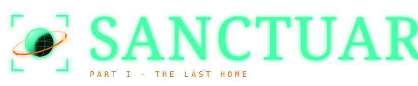<br>
  <sub>Made by <a href="https://github.com/Dashrath175">Dashrath175</a> · © 2026, all rights reserved. Fly safe, Commander.</sub>
</p>
